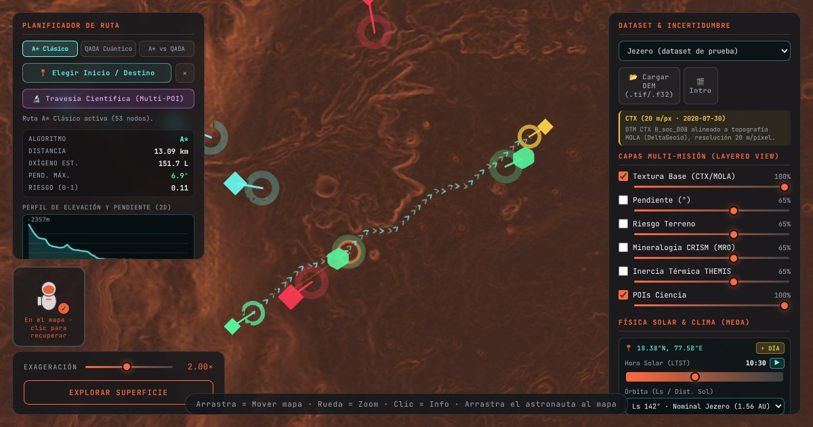

# Marswalk 3D — Exploración EVA en Marte

**🚀 Demo en vivo: https://angelgab3.github.io/Preparation/**

Mapa 3D interactivo para que un astronauta planifique y ejecute una caminata (EVA) en el **cráter Jezero**. Combina datos de varias misiones de la NASA en una sola vista por capas, calcula rutas seguras y estima el consumo de oxígeno según el terreno.

Proyecto para el reto *Interplanetary Survival Guide: Martian Map* — NASA Space Apps Challenge 2026.



## ¿Qué hace?

| Necesidad del astronauta | Cómo la resuelve Marswalk |
| --- | --- |
| Saber dónde está y qué hay alrededor | Relieve 3D real (DEM CTX 20 m/px y HiRISE 1 m/px) con puntos de interés científicos |
| Combinar varios tipos de datos | Capas de textura (CTX/MOLA), pendiente, riesgo, mineralogía CRISM e inercia térmica THEMIS |
| Moverse con seguridad | Rutas óptimas A\* y QAOA que evitan pendientes > 25°, perfil de elevación y estimación de O₂ |
| Conocer las condiciones actuales | Sol, temperatura, viento y polvo (MEDA), simulación de tormenta y evacuación a refugio |
| Ver el lugar antes de llegar | Vista en 1ª/3ª persona con visor EVA: oxígeno, pulso, brújula y mini-radar |

## Inicio rápido

Requiere Node.js 20+.

```bash
npm install
npm run dev
```

Abre `http://localhost:8000/`. Parámetros útiles:

- `?dataset=hirise_jezero` (predeterminado) · `?dataset=jezero_test` · `?dataset=synth_crater` — elige la zona (también desde el selector del panel derecho).
- `?nointro=1` — salta la introducción y abre el mapa directamente.

### Scripts

| Comando | Qué hace |
| --- | --- |
| `npm run dev` | Servidor de desarrollo (Vite, puerto 8000) |
| `npm run build` | Compila a `dist/` |
| `npm run preview` | Sirve `dist/` para probar la versión compilada |
| `npm test` | Pruebas del modelo de salud y rutas (`node --test`) |
| `npm run lint` | ESLint sobre `src/` |
| `npm run check` | Lint + validación de datos + build |

## Controles

**Vista orbital**
- Arrastrar / rueda / clic derecho: rotar, zoom y desplazar.
- Clic en el terreno o en un POI: elevación, pendiente, distancia y fuente científica.
- Arrastra el astronauta al mapa para colocarlo.
- **📍 Elegir Inicio / Destino** traza la ruta; puedes exportarla como `route.json`.
- En móvil, los paneles se abren con las pestañas **Ruta** y **Capas** de la esquina superior.

**Exploración en superficie**
- `W A S D` / flechas: caminar (1.2 m/s) · `Shift`: correr (2.5 m/s) · `Espacio`: saltar (g = 3.71 m/s²).
- `V`: alternar 1ª / 3ª persona · `E`: analizar · `Esc`: volver a la vista orbital.

## Datos

Cada zona vive en `public/data/<dataset_id>/` con este contrato (ver `docs/contrato_4.5.md`):

- `metadata.json` + `heightmap.f32` — DEM en Float32
- `texture.png` — textura base
- `config_fisio.json`, `config_health.json` — parámetros fisiológicos (gravedad, velocidad, O₂)
- `poi.json`, `route.json` — puntos de interés y ruta (opcionales)

Para convertir un GeoTIFF Float32 sin comprimir a este formato (solo usa la biblioteca estándar de Python):

```bash
python3 data_pipeline/convert_dem.py --dem ruta/al/DEM.tif --texture ruta/a/textura.png --dataset-id mi_zona
```

El DEM de Jezero usado es `JEZ_ctx_B_soc_008_DTM_MOLAtopography_DeltaGeoid_20m` (Mars 2020 Science Team / USGS Astrogeology). Para validar todos los datasets:

```bash
npm run validate:data
```

## Despliegue

Cada push a `main` compila y publica el sitio en GitHub Pages mediante `.github/workflows/deploy.yml`. Configuración única en GitHub: **Settings → Pages → Source → GitHub Actions**.

## Estructura

```
index.html           Interfaz (paneles, HUD, intro)
src/                 Código de la app (Three.js)
  main.js            Arranque y bucle principal
  terrain*.js        Carga del DEM, capas, LOD y rutas
  health*.js         Modelo metabólico, O₂ y rutas por salud
  controls.js        Cámara, vistas y movimiento
  cinematic.js       Introducción Tierra → Marte
public/data/         Datasets (DEM, texturas, POIs)
data_pipeline/       Conversión y validación de datos (Python)
tests/               Pruebas unitarias
docs/                Contratos de datos e ideas de HUD
```

> Los terrenos y planetas de la introducción son representaciones artísticas; el DEM científico solo se usa en el mapa principal.
